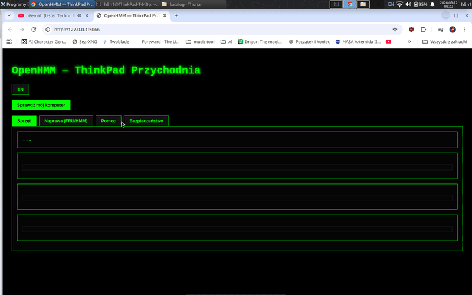

# OpenHMM — ThinkPad Przychodnia / ThinkPad Doctor



Masz starego ThinkPada i Linuxa (Mint / Ubuntu)? Zacznij tutaj.

**Co to jest:** darmowy, lokalny panel który mówi Ci wprost co boli Twój komputer —
temperatury, wentylator, bateria, model + numery części FRU i kroki naprawy po polsku.
Bez kont, bez telemetrii, bez internetu. Tylko Python + Twój sprzęt.

**Czy to dla Ciebie?**

- Masz ThinkPada (T/X/W/P/E/L, stare T420–T480 też) z Linuxem → TAK
- Wentylator wyje, grzeje się, bateria pada, nie wiesz jaką część kupić → TAK
- Chcesz klikać w chmurze i zakładać konto → NIE, to nie to narzędzie

**3 komendy dla laika:**

```bash
./install.sh   # raz: stawia środowisko
./status       # tekst w terminalu: ✅ / ⚠️ / ❌
./dashboard    # strona: http://localhost:5066 (zakładki Sprzęt / Naprawa)
```

**Co dostaniesz:** model z DMI (np. `20AN → ThinkPad T440p`), temperatury z hwmon,
stan thinkfan, baterię %, CPU/RAM + FRU i kroki demontażu z oryginalnego HMM Lenovo.

**Zdrowie jednym rzutem (nowe):**

```bash
./status --check   # jedna linijka: CHECK: ok/warn/crit + kod wyjścia 0/1/2
```

`HEALTH` w zwykłym `./status` mówi też ile baterii realnie zostało
(`wear%` — pojemność dziś vs fabryka). Progi temperatury bierze z kernela,
nie z głowy. A w przeglądarce jest adres `http://localhost:5066/api/health`
z tym samym werdyktem w formacie dla programów.

> ⚠️ Osobny moduł hardeningu (`security-rocket`) zmienia SSH/UFW — najpierw
> `preflight_check.sh`, miej fizyczny dostęp do maszyny. Dashboard sprzętowy
> (ten folder) niczego nie zmienia, tylko czyta.

EN version: see `README.en.md`. Domyślny język: **polski** (`--lang en` / przycisk EN w web).

## Klimat

Projekt zrodzony na ThinkPadzie T440p, w duchu zasady: **wolność to otwarty kod.**
